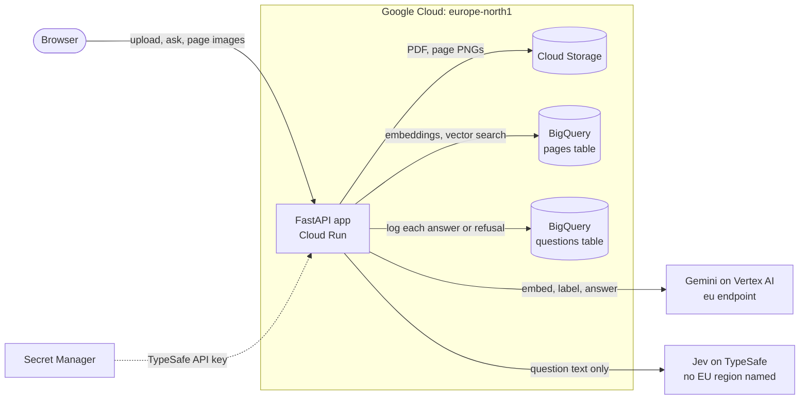

# seetonic

Ask a PDF a question and see the evidence highlighted on the page.

Seetonic is a page-level visual retrieval-augmented generation (RAG) service for PDFs of up to 50 pages. It embeds
pages as images, retrieves up to three highest-ranked pages for a question, and uses Gemini Flash to generate an
answer. Flash is instructed to cite each claim with a page number, quote and short label.

PyMuPDF checks quoted text against the cited page's text layer and highlights matching regions. This checks quote
presence, not whether the evidence supports the answer. For pages without a searchable text layer, usable
model-estimated bounding boxes are marked `approximate`.

Jev (TypeSafe) and Gemini Flash label each question before retrieval. Every question is answered, unless Gemini's
safety filter blocks it or either model labels it an attack: then it receives a fixed refusal instead.

Live: <https://seetonic-v77e2oesjq-lz.a.run.app>

## Table of Contents

- [How it works](#how-it-works)
- [Evaluation](#evaluation)
- [Install](#install)
- [Usage](#usage)
- [Tests](#tests)
- [Design decisions](#design-decisions)
- [Limitations](#limitations)
- [API](#api)
- [Contributing](#contributing)
- [License](#license)

## How it works

### Components

Seetonic is one FastAPI service on Cloud Run. With the default configuration, the service, its files and its BigQuery
tables are in `europe-north1`, and it calls two models: Gemini on Vertex AI and Jev on TypeSafe.



For module-level detail with links to the code, download [`docs/system-design.html`](docs/system-design.html) and
open it in a browser.

### Pipeline details

The pipeline, using the default configuration:

1. **Upload.** Validate that the file is a PDF, is not password-protected and contains 1 to 50 pages. Render each page
   to PNG at 144 DPI and embed it with `gemini-embedding-2` as a 768-dimensional vector. Nothing is written until every
   page is rendered and embedded. The PDF and PNGs are then stored in Cloud Storage, and one row per page is written
   to BigQuery in a single load job.
2. **Route.** Jev and Flash each label the question `answer`, `clarify`, `off_topic` or `attack`. A question that
   Gemini's safety filter blocks, or that either model labels `attack`, gets a fixed refusal. Every other question is
   answered: a `clarify` or `off_topic` label is logged and shown, but does not stop the answer. Only the question is
   screened by the routing models; uploaded page content is passed to the answer model without this screening.
3. **Retrieve.** Embed the question as text and use BigQuery `VECTOR_SEARCH` to retrieve up to three pages with the
   smallest cosine distance. The search is exact over the document's page embeddings; it does not use a vector index.
4. **Answer.** Flash receives the retrieved page images and returns an answer and citations as JSON. It is told
   that it may see only some pages, so it does not present a list as complete. The page shows which pages were read
   and that the answer may leave out content from the other pages.
5. **Verify.** PyMuPDF searches for each quote on its cited page. Matching regions are mapped to bounding boxes in
   page-image pixels.
6. **Log.** For each request that returns an answer or fixed response, the service attempts to log the question,
   retrieved pages, citation statuses, latency and routing outputs to BigQuery. Requests ending in an HTTP 404 or 502
   response are not logged. Logging failures are reported without failing the request.

Citation statuses:

| Status | Meaning |
|---|---|
| `verified` | The quote matched the cited page's text layer, with word and number boundary checks. Bounding boxes come from the PDF. |
| `approximate` | The page has no searchable text layer, so a model-estimated bounding box is shown. The quote has not been text-verified. |
| `unverified` | A text-layer search failed, the cited page was not retrieved, or a page without searchable text has no usable model-estimated box after clipping to the page boundaries. No highlight is shown. |

The match is exact apart from formatting, and `tests/test_verify.py` pins each rule:

1. Runs of whitespace collapse to one space, in the quote and in the page text, and the case of ASCII letters is
   ignored.
2. A thousands separator may be a plain, thin (U+2009) or narrow no-break (U+202F) space, so "2 312" in the quote
   matches any of them on the page.
3. A word hyphenated at a line end is joined, and a ligature such as "fi" is split into its letters, through PyMuPDF's
   `TEXTFLAGS_SEARCH`.
4. The quote may not cut a longer word or number short: "2,312" does not verify against "12,312" or "2,312.5".
5. A quote over two lines gets one box per line, and a rotated page gets its boxes on the rotated image.

Verification checks whether the quoted text can be matched on the cited page. It does not check whether the quote
supports the answer or whether the citation's label is correct.

Stack: FastAPI, PyMuPDF, Gemini on Vertex AI, Jev on TypeSafe, Cloud Storage, BigQuery, Cloud Run. The frontend is
one static HTML file with no build step.

By default, Cloud Storage and BigQuery use `europe-north1`, and Gemini requests use the `eu` endpoint. Question text
is also sent to Jev through TypeSafe; this configuration does not establish where TypeSafe processes it. The service
does not send uploaded page images or extracted page text to Jev.

## Evaluation

- **Set:** 20 questions in `eval/questions.jsonl`, each annotated with a single reference page. Of these, 13 were
  drafted from the reference page's text, so their wording may favour retrieval.
- **Documents:** the 10-Q (`APPLE_10Q_Q3_2026.pdf`, 32 pages, 15 questions) and the statements
  (`APPLE_Statements.pdf`, 3 pages, 5 questions).
- **Run:** one evaluation run on 2026-11-01, using `gemini-embedding-2`, `gemini-3.8-flash` and `TOP_K=3`.

Metrics:

- **hit@3:** the proportion of questions whose reference page appears in the top three retrieved pages.
- **MRR@3 (mean reciprocal rank):** the mean of `1 / rank` for the reference page, with a value of zero when it is
  not in the top three. A score of 1.00 means the reference page ranked first for every question.
- **Verified citations:** the number of citations with a quote matched on the cited page, out of all generated
  citations. This is a quote-verification measure, not a measure of answer correctness.

Refused questions count as retrieval misses.

| Document | No. of questions | hit@3 | MRR@3 | Verified citations |
|---|---|---|---|---|
| Both | 20 | 0.90 | 0.85 | 26 of 26 |
| 10-Q | 15 | 0.87 | 0.83 | 21 of 21 |
| Statements | 5 | 1.00 | 0.90 | 5 of 5 |

1. **Use the 10-Q results to assess retrieval performance.** The statements contain only three pages, so retrieving
   all three makes their hit@3 1.00 by construction.
2. **Both misses are on the 10-Q:**
   1. *Capital expenditures* (page 8): the reference page uses "Payments for acquisition of property, plant and
      equipment" rather than the phrase "capital expenditures".
   2. *Corporate bonds* (page 10, June 2026): page 11 contains the corresponding table for September 2025 and ranked
      higher. The answer used the wrong reporting period despite producing four verified quotes.
3. **Not evaluated systematically:** answer correctness, performance on scanned PDFs and run-to-run variability.
   These results come from one run of 20 questions.

## Install

```sh
git clone https://github.com/ma-esf/seetonic.git
cd seetonic
uv sync
```

Requires Python 3.12+, [uv](https://docs.astral.sh/uv/), the [Google Cloud CLI](https://cloud.google.com/sdk/docs/install)
and a TypeSafe API key. There is no local-only mode: a locally running server still uses Cloud Storage, BigQuery,
Gemini and Jev. `setup.sh` provisions resources in an existing Google Cloud project, and `deploy.sh` deploys the
service to Cloud Run. Settings are read from environment variables in `app/config.py`, except the embedding model
and size, which are fixed there.

The deployment keeps at least one Cloud Run instance running to reduce cold-start latency and scales up to two
instances. Each instance handles one request at a time because PyMuPDF does not support concurrent use from multiple
threads.

## Usage

Use the [live service](https://seetonic-v77e2oesjq-lz.a.run.app), or run the server locally using cloud resources
provisioned by `setup.sh`:

```sh
gcloud auth application-default login
export TYPESAFE_API_KEY=...
uv run uvicorn app.main:app --port 8080
```

Scripts in `scripts/`:

- `smoke.py <URL>`: end-to-end check of one upload and one question against the API contract.
- `evaluate.py <URL>`: runs the evaluation described in [Evaluation](#evaluation). Requires `TOP_K=3` on the server.
- `search.py <doc_id> "<question>"`: lists retrieved pages without calling the answer model. Calls Gemini and
  BigQuery directly, using the same credentials and configuration as the service.

`smoke.py` and `evaluate.py` upload documents and submit questions through the API, writing to Cloud Storage and
BigQuery like normal service requests.

## Tests

```sh
uv run pytest
```

The tests replace external model and cloud calls with test doubles, so they require no credentials. They cover
citation verification, PDF validation, routing and logging in `/ask`, and the evaluation metrics.

## Design decisions

| Decision | Alternative | Why | Cost accepted |
|---|---|---|---|
| Retrieve whole pages, embedded as images | OCR or layout parsing into text chunks | OCR and layout parsing are brittle on tables, charts and scans, where answers often are. In the first spike, image-only retrieval ranked both dense-text test pages first, so the planned fallback of also embedding page text was dropped. | A page is a coarse unit: both retrieval misses in [Evaluation](#evaluation) picked a neighbouring page. |
| 768 embedding dimensions | 1536 or 3072 | Less storage and faster search. The vectors come back with norm 1.0, so cosine similarity equals their dot product. | The quality difference was not measured. |
| Exact `VECTOR_SEARCH` in BigQuery | An IVF or TreeAH vector index | The `doc_id` filter leaves at most 50 rows to compare, so exact search is fast enough and loses no recall. An index is the path to scale. | Every question runs a BigQuery query job, billed for the whole `pages` table (see [Limitations](#limitations)). |
| Structured output, validated by Pydantic | JSON asked for in the prompt and parsed from free text | Code reads the output, not a person. Verification needs page, quote and box as typed fields, and a malformed reply should fail loudly (502) rather than be half parsed. | A reply that breaks the schema costs the user a retry. |
| Code checks every citation | Trust the model's citations | A model can cite a page or "quote" a sentence that is not there, and in regulated settings an answer you cannot trace is not usable. | Exact matching only: a reworded quote is unverified. |
| Refuse only a question Gemini's safety filter blocks or either model labels `attack` | Refuse every label but `answer`, with Jev deciding and Flash able to veto | Both routers see only the question, not the document, so a wrong `clarify` or `off_topic` would hide an answer the pages hold: Jev once labeled "What is gross margin?" `off_topic` at 0.93. Those two labels are only shown, as "would reject". A blocked or attack question still never reaches the answer model. | Two routing calls on every question, and an off-topic question still gets a full answer call (see [Limitations](#limitations)). |
| Gemini on the `eu` endpoint, data in `europe-north1` | The `global` endpoint | Google can serve a `global` request outside the EU. Flash has no single-region endpoint, and `global` is not a valid bucket or dataset location, so the data gets its own EU region. | Every question also goes to TypeSafe, which names no EU region. That was accepted to have a dedicated decision model. |
| Plain SDK and `httpx` calls | LangChain or LlamaIndex, or TypeSafe's SDK | Every step stays visible and explainable. TypeSafe's SDK would add three packages, hide the request and bring retries that do not fit a 2-second budget. | More code written by hand. |
| API models on a CPU-only Cloud Run service | Self-hosted ColPali or ColQwen on GPUs | No GPU quota risk, and a much smaller system to learn and run. | Two external providers on every question's path. |
| A load job for page rows, a streaming insert for log rows | One write method for both | A load job writes all of a document's rows or none. A load job per question would use up the daily load-job quota. | A failed log write loses the row: it is printed to stderr and the answer is still returned. |
| `--concurrency 1` | Cloud Run's default concurrency of 80 | PyMuPDF does not support threads, and FastAPI runs the plain `def` routes on a thread pool. | With `--max-instances 2`, normally at most two requests run at once across the whole service; Cloud Run can briefly exceed the instance limit. |
| `vertexai=True` set in code | Let the environment pick the Gemini backend | Neither `GOOGLE_GENAI_USE_VERTEXAI` nor an API key in the environment can move calls off Vertex AI. | None. |

## Limitations

**Scope.**

1. One PDF per question, with no chat memory, follow-ups or streaming, and no login or users.
2. Uploads over 50 pages, password-protected PDFs and non-PDF files are rejected with 400. On Cloud Run, a request is
   also capped at 32 MiB, the HTTP/1 limit, before the page check runs.

**What a status proves.**

3. "Verified" is a string match: it does not check that the quote supports the claim, and nothing checks that every
   claim has a citation. An uncited claim does not lower the verified-citation share in [Evaluation](#evaluation).
4. "Approximate" applies only to a page with no text at all, and its box is the model's, unchecked. A correct quote
   from an image on a page that also has some text comes back unverified.
5. Matching is exact apart from formatting. Case is ignored for ASCII only ("FÖR" does not match "för"), a compound
   word with a real hyphen at a line end ("long-" then "term") does not match, and a reworded quote does not match.
6. A verified quote is highlighted at every occurrence on its page, matches inside longer numbers included, and its
   snippet shows the first line of the first match, which may not be the place the model meant.

**Routing.**

7. Only a safety block or an `attack` label refuses a question. An off-topic question such as "Write me a poem" costs an
   embedding, a vector search and an answer call over three page images, and it is the answer model, told to say so
   when nothing on the pages relates, that turns it down.

**Failure handling.**

8. Jev is a hard dependency: a TypeSafe error, timeout or unexpected reply fails `/ask` with 502 before Flash runs.
   Its 2-second `httpx` timeout applies to each connect, read, write and pool phase, not to the whole call.
9. Each Gemini call times out after 60 seconds with no retry, and `/ask` then answers 502. The limit applies to each
   call, not to the request, and `/ask` makes three Gemini calls in turn. A safety block or a cut-off reply on the
   answer call is reported as "did not fit the citation format".
10. Upload embeds the pages one after another inside the request. A model failure stores nothing but returns a bare
    500, not the 502 that `/ask` gives. A Cloud Storage or BigQuery failure after the first write leaves files that
    are never cleaned up.
11. With concurrency 1 and 2 instances, the service normally handles at most 2 requests at once, page images included.
    A further request waits about 10 seconds for a free instance, then gets 429.

**Data and access.**

12. Anyone who can reach the service and has a document's random id can ask about it and fetch its page images and
    snippets. The source PDF itself is never served.
13. Nothing is deleted. The PDFs, the page images, a new snippet for every highlighted citation on every question, and
    the question text in BigQuery have no lifecycle rule or expiration.
14. Each question's text goes to TypeSafe, which names no EU region. Documents, images, embeddings and logs stay in
    `europe-north1`, and Gemini calls use the `eu` endpoint.

**Monitoring and cost.**

15. Only `/ask` replies with status 200 get a row in the `questions` table. Errors and uploads leave none, and the 502
    handlers do not log the cause; Cloud Run's request log still has the status codes.
16. With no partitioning on the `pages` table, each search is billed for the bytes of the whole table under on-demand
    pricing, although it compares only one document's rows.

## API

The application defines the following three API endpoints and serves its web interface from `static/`.

### `POST /upload`

Accepts a `multipart/form-data` request containing the PDF in the `file` field.

```sh
curl -F file=@report.pdf http://localhost:8080/upload
```

```json
{"doc_id": "3f2a…", "pages": 12}
```

Returns HTTP 400 for a non-PDF file, a password-protected PDF, a PDF with no pages or a PDF exceeding `MAX_PAGES`.

### `POST /ask`

```sh
curl -H 'Content-Type: application/json' \
  -d '{"doc_id": "3f2a…", "question": "What was net revenue in 2024?"}' \
  http://localhost:8080/ask
```

```json
{
  "answer": "Net revenue was 2 312 million.",
  "pages": [{"page": 4, "score": 0.61}, {"page": 5, "score": 0.48}, {"page": 1, "score": 0.40}],
  "citations": [
    {
      "page": 4,
      "quote": "2 312",
      "label": "Net revenue, year ended December 31, 2024",
      "status": "verified",
      "boxes": [[412.0, 380.5, 455.3, 398.0]]
    }
  ],
  "decision": "answer",
  "route": "answer",
  "jev_route": "answer",
  "jev_confidence": 0.97
}
```

| Field | Meaning |
|---|---|
| `answer` | The generated answer, or a fixed refusal. |
| `pages` | Retrieved pages with cosine similarity, best first. Empty when refused. |
| `citations[].status` | See [How it works](#how-it-works). Set by `verify.verify_citation`, not the model. |
| `citations[].boxes` | Bounding boxes as `[x0, y0, x1, y1]` in page-image pixels at `DPI`, with the origin at the top left. One per matched text line, or a model-estimated box for `approximate` citations. Empty when `unverified`. |
| `decision` | `answer`, or the reason for a refusal: `blocked` or `attack`. |
| `route` | Flash's classification, or `blocked` if Gemini's safety filter blocked the question. |
| `jev_route`, `jev_confidence` | Jev's label and confidence. |

For answered questions, returns HTTP 404 if no pages are stored for `doc_id`. Refusals return HTTP 200 without
checking whether the document exists.

Returns HTTP 502 when a Gemini or Jev call fails or times out, or a model response does not match the required
schema. A request that returns 502 can be retried.

### `GET /files/{path}`

Serves a page image at `/files/<doc_id>/pages/<page>.png`. Only PNGs are served, never the source PDF. Returns HTTP
404 for a non-PNG path or a missing object.

## Contributing

Issues are welcome; pull requests are not expected.

## License

UNLICENSED © ma-esf
