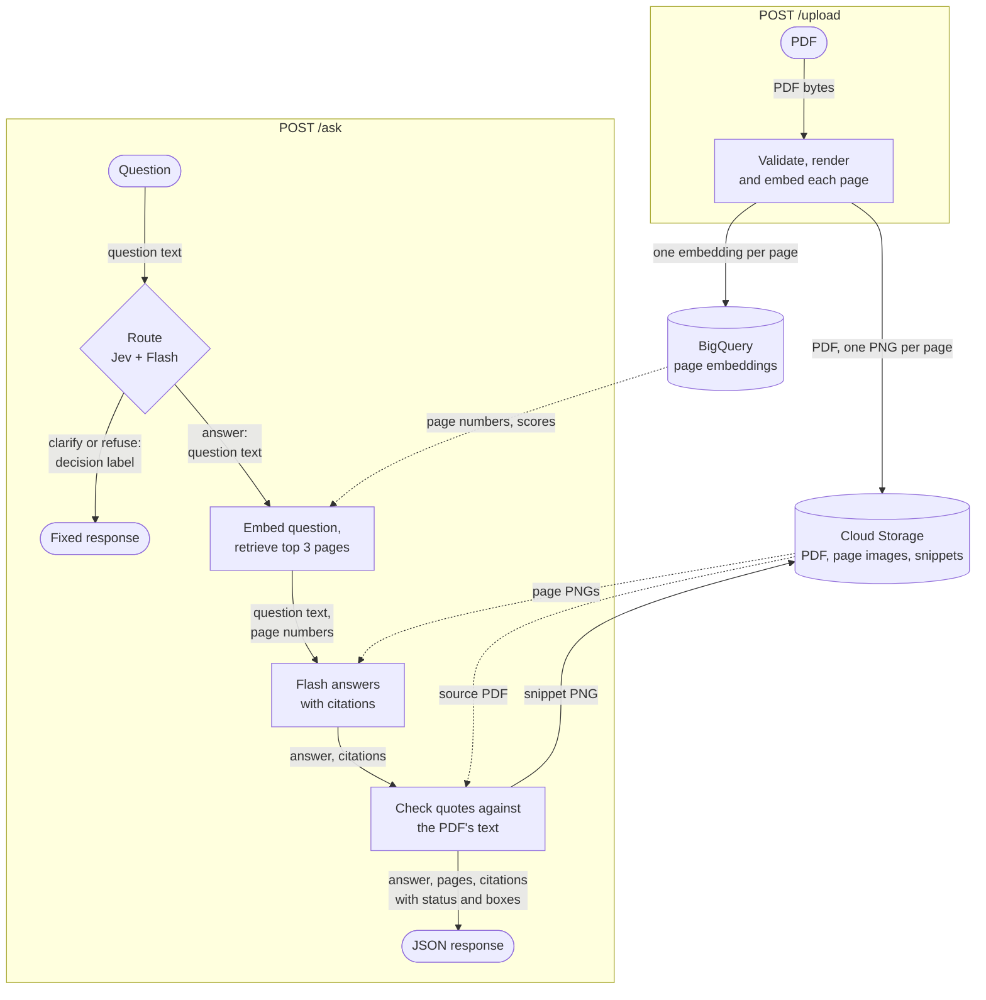

# seetonic

Ask a PDF a question and see the evidence highlighted on the page.

Seetonic is a page-level visual retrieval-augmented generation (RAG) service for PDFs of up to 50 pages. It embeds
pages as images, retrieves up to three highest-ranked pages for a question, and uses Gemini Flash to generate an
answer. Flash is instructed to cite each claim with a page number, quote and short label.

PyMuPDF checks quoted text against the cited page's text layer and highlights matching regions. This checks quote
presence, not whether the evidence supports the answer. For pages without a searchable text layer, usable
model-estimated bounding boxes are marked `approximate`.

Jev (TypeSafe) and Gemini Flash classify each question before retrieval. Questions routed to clarification or refusal
receive a fixed response instead of proceeding to answer generation.

Live: <https://seetonic-v77e2oesjq-lz.a.run.app>

## Table of Contents

- [How it works](#how-it-works)
- [Evaluation](#evaluation)
- [Install](#install)
- [Usage](#usage)
- [Tests](#tests)
- [API](#api)
- [Contributing](#contributing)
- [License](#license)

## How it works



Solid arrows are steps and writes; dotted arrows are reads. Each label names what the arrow carries.

The pipeline, using the default configuration:

1. **Upload.** Validate that the file is a PDF, is not password-protected and contains 1 to 50 pages. Render each page
   to PNG at 144 DPI and embed it with `gemini-embedding-2` as a 768-dimensional vector. Nothing is written until every
   page is rendered and embedded. The PDF and PNGs are then stored in Cloud Storage, and one row per page is written
   to BigQuery in a single load job.
2. **Route.** Jev and Flash each classify the question as `answer`, `clarify`, `off_topic` or `attack`. Jev's label
   determines the routing decision unless Flash labels the question `attack` or Gemini's safety filter blocks it.
   Any decision other than `answer` produces a fixed clarification or refusal response. Only the question is
   screened by the routing models; uploaded page content is passed to the answer model without this screening.
3. **Retrieve.** Embed the question as text and use BigQuery `VECTOR_SEARCH` to retrieve up to three pages with the
   smallest cosine distance. The search is exact over the document's page embeddings; it does not use a vector index.
4. **Answer.** Flash receives the retrieved page images and returns an answer and citations as JSON.
5. **Verify.** PyMuPDF searches for each quote on its cited page. Matching regions are mapped to bounding boxes in
   page-image pixels, and the first box is cropped to produce a snippet.
6. **Log.** For each request that returns an answer or fixed response, the service attempts to log the question,
   retrieved pages, citation statuses, latency and routing outputs to BigQuery. Requests ending in an HTTP 404 or 502
   response are not logged. Logging failures are reported without failing the request.

Citation statuses:

| Status | Meaning |
|---|---|
| `verified` | The quote matched the cited page's text layer, with word and number boundary checks. Bounding boxes come from the PDF. |
| `approximate` | The page has no searchable text layer, so a model-estimated bounding box is shown. The quote has not been text-verified. |
| `unverified` | A text-layer search failed, the cited page was not retrieved, or a page without searchable text has no usable model-estimated box after clipping to the page boundaries. No highlight is shown. |

Verification checks whether the quoted text can be matched on the cited page. It does not check whether the quote
supports the answer or whether the citation's label is correct.

Stack: FastAPI, PyMuPDF, Gemini on Vertex AI, Jev on TypeSafe, Cloud Storage, BigQuery, Cloud Run. The frontend is
one static HTML file with no build step.

By default, Cloud Storage and BigQuery use `europe-north1`, and Gemini requests use the `eu` endpoint. Question text
is also sent to Jev through TypeSafe; this configuration does not establish where TypeSafe processes it. The service
does not send uploaded page images or extracted page text to Jev.

## Evaluation

- **Set:** 20 questions in `eval/questions.jsonl`, each annotated with a single reference page. Of these, 13 were
  drafted from the reference page's text, so their wording may favour retrieval.
- **Documents:** the 10-Q (`APPLE_10Q_Q3_2026.pdf`, 32 pages, 15 questions) and the statements
  (`APPLE_Statements.pdf`, 3 pages, 5 questions).
- **Run:** one evaluation run on 2026-11-01, using `gemini-embedding-2`, `gemini-3.8-flash` and `TOP_K=3`.

Metrics:

- **hit@3:** the proportion of questions whose reference page appears in the top three retrieved pages.
- **MRR@3 (mean reciprocal rank):** the mean of `1 / rank` for the reference page, with a value of zero when it is
  not in the top three. A score of 1.00 means the reference page ranked first for every question.
- **Verified citations:** the number of citations with a quote matched on the cited page, out of all generated
  citations. This is a quote-verification measure, not a measure of answer correctness.

Questions rejected by the router count as retrieval misses.

| Document | No. of questions | hit@3 | MRR@3 | Verified citations |
|---|---|---|---|---|
| Both | 20 | 0.90 | 0.85 | 26 of 26 |
| 10-Q | 15 | 0.87 | 0.83 | 21 of 21 |
| Statements | 5 | 1.00 | 0.90 | 5 of 5 |

1. **Use the 10-Q results to assess retrieval performance.** The statements contain only three pages, so retrieving
   all three makes their hit@3 1.00 by construction.
2. **Both misses are on the 10-Q:**
   1. *Capital expenditures* (page 8): the reference page uses "Payments for acquisition of property, plant and
      equipment" rather than the phrase "capital expenditures".
   2. *Corporate bonds* (page 10, June 2026): page 11 contains the corresponding table for September 2025 and ranked
      higher. The answer used the wrong reporting period despite producing four verified quotes.
3. **Not evaluated systematically:** answer correctness, performance on scanned PDFs and run-to-run variability.
   These results come from one run of 20 questions.

## Install

```sh
git clone https://github.com/ma-esf/seetonic.git
cd seetonic
uv sync
```

Requires Python 3.12+, [uv](https://docs.astral.sh/uv/), the [Google Cloud CLI](https://cloud.google.com/sdk/docs/install)
and a TypeSafe API key. There is no local-only mode: a locally running server still uses Cloud Storage, BigQuery,
Gemini and Jev. `setup.sh` provisions resources in an existing Google Cloud project, and `deploy.sh` deploys the
service to Cloud Run. Settings are read from environment variables in `app/config.py`.

The deployment keeps at least one Cloud Run instance running to reduce cold-start latency and scales up to two
instances. Each instance handles one request at a time because PyMuPDF does not support concurrent use from multiple
threads.

## Usage

Use the [live service](https://seetonic-v77e2oesjq-lz.a.run.app), or run the server locally using cloud resources
provisioned by `setup.sh`:

```sh
gcloud auth application-default login
export TYPESAFE_API_KEY=...
uv run uvicorn app.main:app --port 8080
```

Scripts in `scripts/`:

- `smoke.py <URL>`: end-to-end check of one upload and one question against the API contract.
- `evaluate.py <URL>`: runs the evaluation described in [Evaluation](#evaluation). Requires `TOP_K=3` on the server.
- `search.py <doc_id> "<question>"`: lists retrieved pages without calling the answer model. Calls Gemini and
  BigQuery directly, using the same credentials and configuration as the service.

`smoke.py` and `evaluate.py` upload documents and submit questions through the API, writing to Cloud Storage and
BigQuery like normal service requests.

## Tests

```sh
uv run pytest
```

The tests replace external model and cloud calls with test doubles, so they require no credentials. They cover
citation verification, PDF validation, routing and logging in `/ask`, and the evaluation metrics.

## API

The application defines the following three API endpoints and serves its web interface from `static/`.

### `POST /upload`

Accepts a `multipart/form-data` request containing the PDF in the `file` field.

```sh
curl -F file=@report.pdf http://localhost:8080/upload
```

```json
{"doc_id": "3f2a…", "pages": 12}
```

Returns HTTP 400 for a non-PDF file, a password-protected PDF, a PDF with no pages or a PDF exceeding `MAX_PAGES`.

### `POST /ask`

```sh
curl -H 'Content-Type: application/json' \
  -d '{"doc_id": "3f2a…", "question": "What was net revenue in 2024?"}' \
  http://localhost:8080/ask
```

```json
{
  "answer": "Net revenue was 2 312 million.",
  "pages": [{"page": 4, "score": 0.61}, {"page": 5, "score": 0.48}, {"page": 1, "score": 0.40}],
  "citations": [
    {
      "page": 4,
      "quote": "2 312",
      "label": "Net revenue, year ended December 31, 2024",
      "status": "verified",
      "boxes": [[412.0, 380.5, 455.3, 398.0]],
      "snippet_url": "/files/3f2a…/snippets/9c1e….png"
    }
  ],
  "decision": "answer",
  "route": "answer",
  "jev_route": "answer",
  "jev_confidence": 0.97
}
```

| Field | Meaning |
|---|---|
| `answer` | The generated answer, or a fixed response for clarification or refusal. |
| `pages` | Retrieved pages with cosine similarity, best first. Empty when refused. |
| `citations[].status` | See [How it works](#how-it-works). Set by `verify.verify_citation`, not the model. |
| `citations[].boxes` | Bounding boxes as `[x0, y0, x1, y1]` in page-image pixels at `DPI`, with the origin at the top left. One per matched text line, or a model-estimated box for `approximate` citations. Empty when `unverified`. |
| `citations[].snippet_url` | A crop of the first box, or `null`. |
| `decision` | The effective routing decision: `answer`, `clarify`, `off_topic`, `attack` or `blocked`. |
| `route` | Flash's classification, or `blocked` if Gemini's safety filter blocked the question. |
| `jev_route`, `jev_confidence` | Jev's label and confidence. |

For questions routed to answer generation, returns HTTP 404 if no pages are stored for `doc_id`. Clarification and
refusal responses return HTTP 200 without checking whether the document exists.

Returns HTTP 502 when a Gemini or Jev call fails or a model response does not match the required schema. A request
that returns 502 can be retried.

### `GET /files/{path}`

Serves a page image at `/files/<doc_id>/pages/<page>.png` or a snippet at its `snippet_url`. Only PNGs are served,
never the source PDF. Returns HTTP 404 for a non-PNG path or a missing object.

## Contributing

Issues are welcome; pull requests are not expected.

## License

UNLICENSED © ma-esf
